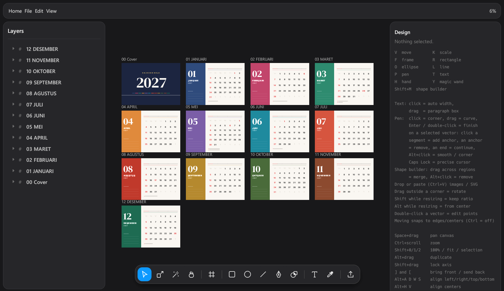
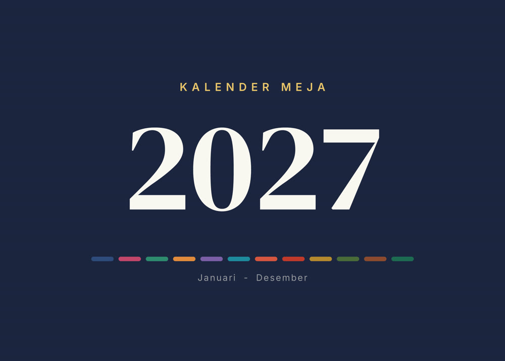
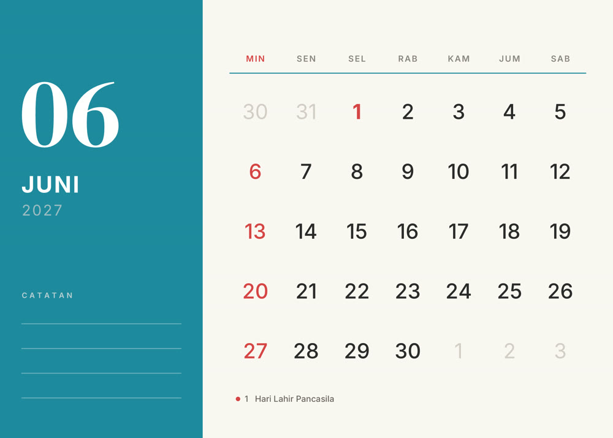
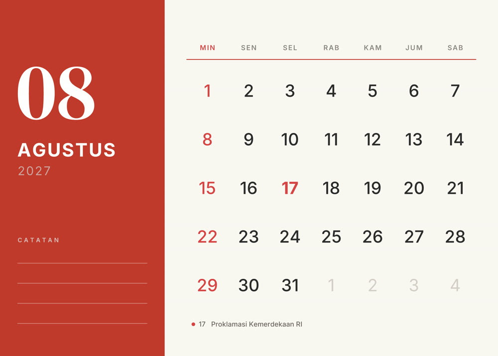

<p align="center"></p>

<h1 align="center">Kanvas</h1>

<p align="center">
  <b>A lightweight, native design editor for Windows, macOS and Linux, written in Rust.</b><br>
  Infinite canvas, unlimited frames, the whole Google Fonts catalog, vector tools and clean exports,<br>
  in a single small download with nothing to install.
</p>

<p align="center">
  
  
  
  
  
</p>

<p align="center">
  <a href="https://github.com/fadhelgame/Untitled/releases/latest/download/Kanvas.exe"></a>
  <a href="https://github.com/fadhelgame/Untitled/releases/latest/download/Kanvas-macos-arm64.zip"></a>
  <a href="https://github.com/fadhelgame/Untitled/releases/latest/download/Kanvas-linux-x86_64.tar.gz"></a>
</p>

<br>

<p align="center">
  
  <br>
  <sub>A 13-page desk calendar on one canvas: every page is a frame, and every frame exports on its own.</sub>
</p>

<p align="center">
  <a href="#download">Download</a> ·
  <a href="#features">Features</a> ·
  <a href="#everything-in-the-box">Everything in the box</a> ·
  <a href="#made-with-kanvas">Made with Kanvas</a> ·
  <a href="#shortcuts">Shortcuts</a> ·
  <a href="#built-for-ai-assistants">AI assistants</a> ·
  <a href="#build-from-source">Build</a>
</p>

<br>

<table>
  <tr>
    <td width="25%" valign="top">
      <h3>⚡ Native and fast</h3>
      No Electron and no web view. Kanvas is one Rust program drawing on the GPU, and it stays smooth with hundreds of frames.
    </td>
    <td width="25%" valign="top">
      <h3>📦 Nothing to install</h3>
      One file per platform. Download it, open it, start designing. No installer, no account and no sign-in.
    </td>
    <td width="25%" valign="top">
      <h3>🔤 Every Google Font</h3>
      Browse the whole Google Fonts catalog with live previews. A font is downloaded the first time you use it, then kept for offline work.
    </td>
    <td width="25%" valign="top">
      <h3>🤖 AI-ready</h3>
      An optional MCP server lets an AI assistant read your document, build layouts and check the result, while you watch it happen.
    </td>
  </tr>
</table>

<br>

## Download

| | Download | Runs on |
|---|---|---|
| **Windows** | [Kanvas.exe](https://github.com/fadhelgame/Untitled/releases/latest/download/Kanvas.exe) | Windows 64-bit |
| **macOS** | [Kanvas-macos-arm64.zip](https://github.com/fadhelgame/Untitled/releases/latest/download/Kanvas-macos-arm64.zip) | Apple Silicon (M1 or newer), macOS 13.4 or newer |
| **Linux** | [Kanvas-linux-x86_64.tar.gz](https://github.com/fadhelgame/Untitled/releases/latest/download/Kanvas-linux-x86_64.tar.gz) | x86-64, X11 or Wayland |

The macOS and Linux builds are new and **experimental**. If something misbehaves, please [open an issue](https://github.com/fadhelgame/Untitled/issues).

**Windows.** Double-click `Kanvas.exe`. There is no installer.

> [!NOTE]
> The first time you open it, Windows may show **"Windows protected your PC"**, because the app is not code-signed yet. Click **More info → Run anyway**.

**macOS.** Unzip the download and move `Kanvas.app` to Applications.

> [!NOTE]
> The app is not signed with an Apple developer certificate, so macOS blocks it the first time. Open it once, dismiss the warning, then go to **System Settings → Privacy & Security** and click **Open Anyway**. Or clear the download flag in Terminal:
>
> ```sh
> xattr -cr /Applications/Kanvas.app
> ```
>
> Intel Macs are not supported yet.

**Linux.** Unpack the archive and run the `kanvas` file inside:

```sh
tar -xzf Kanvas-linux-x86_64.tar.gz
./kanvas
```

It is built on Ubuntu 24.04, so an older distribution may be missing the system libraries it needs. The open and save dialogs use the XDG desktop portal.

Google Fonts need an internet connection the first time a font is used. Everything else works offline.

## Features

Every screenshot here is the real app.

<table>
  <tr>
    <td width="50%" valign="top">
      
      <br>
      <sub>A selected frame, with its position, size, fill and stroke in the Design panel.</sub>
      <h3>Frames without limits</h3>
      Put as many frames as you like on one infinite canvas: a whole app flow, a slide deck, or twelve months of a calendar. Zoom from the big picture down to a single pixel.
      <br><br>
      <b>Frames inside frames</b>, as deep as you need: draw a frame in a frame, or drag one in, and it becomes a container that clips its content, such as a card, a header or a list row. Click selects the container, double-click goes one level in, <code>Ctrl</code>+click picks the deepest object.
      <br><br>
      <b>Nearly 60 frame presets</b> for phones, tablets, desktops, slides, watches, paper sizes (A3 to A6, Letter, business card) and social posts (Instagram, TikTok, X, Facebook).
    </td>
    <td width="50%" valign="top">
      
      <br>
      <sub>A 620 px headline in DM Serif Display, sharp at any zoom.</sub>
      <h3>Type that stays sharp</h3>
      Text is drawn from the font's own outlines, so a huge headline is as crisp as body text at every zoom level. Click for auto-width text, or drag for a paragraph box that wraps.
      <br><br>
      Change font, weight, size, color, italics, <b>underline or strikethrough</b> for <b>just the selected characters</b>, and set line height, letter spacing and alignment (left, center, right or <b>justified</b>) for the whole block.
      <br><br>
      Turn a text into a <b>bulleted or numbered list</b>: every paragraph gets its marker and wrapped lines hang under their own text. Drag the top or bottom handle of a paragraph to give it a <b>fixed height</b>, then align its lines to the top, middle or bottom of the box. Put a <b>text on a path</b> (<code>Ctrl+Alt+P</code> with a text and a shape selected, or click the outline of an unfilled shape with the Text tool): it runs along a vector path, line, ellipse or rectangle with every letter turned to the curve, follows the shape live when you move or reshape it, slides along when you drag it, and can be flipped to the other side. <b>Outline text</b> (<code>Ctrl+Shift+O</code>) turns any text, straight or on a path, into vector paths of its letters.
      <br><br>
      <b>Find and replace</b> (<code>Ctrl+F</code> / <code>Ctrl+H</code>) searches the text of every layer on this page, on all pages or in the selection, with <i>Match case</i> and <i>Whole word</i>. Step through the matches and the canvas follows, with every match highlighted; replace one at a time or all at once, as a single undo step, and styled characters keep their style.
    </td>
  </tr>
  <tr>
    <td width="50%" valign="top">
      
      <br>
      <sub>Gradients, vector paths, styled text and a Multiply blend, in a document with 501 frames and 8,014 layers.</sub>
      <h3>Color, gradients and blending</h3>
      Solid fills, linear and radial gradients with draggable stops, strokes (solid or dashed; inside, centered or outside; butt, round or square ends and mitered, round or beveled corners, drawn the same on the canvas and in every export), opacity, corner radius and a <b>drop shadow</b> (offset, blur and color) that works on any object, including text and cut-out images. <b>Layer blur</b> softens an object, a frame with everything in it, or a whole group as one picture. An <b>inner shadow</b> (offset, blur and color) falls inside a shape, a text, an image or a frame, over its fill and under its stroke, and can be combined with a drop shadow. <b>Background blur</b> turns a see-through shape or frame into frosted glass: whatever lies behind it shows blurred inside its outline, live on the canvas, and in PNG, JPG, SVG and PDF exports (there as an embedded picture of the blurred backdrop). <b>Color styles</b> and <b>text styles</b> keep a whole document consistent: change the style once and every object that uses it follows. A built-in color picker with hex and alpha, plus an eyedropper with a pixel loupe that samples any pixel in the window.
      <br><br>
      <b>7 blend modes:</b> Normal, Darken, Multiply, Lighten, Screen, Plus lighter and Exclusion.
    </td>
    <td width="50%" valign="top">
      <h3>Vector tools</h3>
      The <b>Polygon / star</b> tool makes regular polygons and stars with any number of points. Draw with the <b>Pen</b>: click for corners, drag for curves. Double-click any path to edit its points, add or remove anchors, or continue an open path.
      <br><br>
      The <b>Shape builder</b> splits overlapping shapes into regions. Drag across regions to merge them, Alt-click to remove them. The result is clean bezier curves, not jagged polygons.
      <h3>Components</h3>
      Turn a frame into a <b>component</b> (<code>Ctrl+Alt+K</code>) and every copy of it is an <b>instance</b>: change the main component and all its instances follow, on every page. An instance keeps what you changed on it (a label, a color, a photo) and still takes everything else from the main; it can be resized, and components can hold instances of other components. The <i>Components</i> button in the toolbar lists them all, one click to place.
      <h3>Constraints</h3>
      Tell each layer in a frame what to hold on to when the frame is resized: <b>left</b>, <b>right</b>, <b>left and right</b> (it stretches), <b>center</b> or <b>scale</b>, and the same from top to bottom. Pick them in the <i>Constraints</i> section of the Design panel, from the dropdowns or by clicking the sides of the little frame. Frames inside the frame pass the change on to their own layers, and a resized instance lays out its layers by the constraints of the main component. Hold <code>Ctrl</code> while dragging a resize handle to leave the content where it is.
      <h3>Auto layout</h3>
      Press <code>Shift+A</code> and a frame places its children itself: in a <b>row</b>, a <b>column</b> or <b>wrapping rows</b>, with a gap, padding and alignment (or <i>Auto</i> gap: space between). The direction, gap and padding are read off how the layers are arranged, and loose layers are wrapped in a new frame. A frame can <b>hug</b> its contents and an item can <b>fill</b> the room that is left, so a button grows with its label and a card with its text, also in an <b>instance</b> whose label you changed. Drag an item to re-order it while the others make room, drop anything into the row at the place you point at, or swap neighbours with the arrow keys. <i>Absolute position</i> takes a layer out of the flow and back under its constraints. <code>Alt+Shift+A</code> removes the layout and leaves everything where it is.
      <h3>Select smarter</h3>
      The <b>Magic wand</b> selects every object that shares a property with the one you click, with a tolerance for near-matching colors. Objects snap to edges and centers of their neighbors with guide lines as you move them, and to their <b>spacing</b>: when the gap to a neighbor matches the gap between two others, the object snaps there and the equal gaps are marked with their size. Turn on <b>rulers</b> with <code>Shift+R</code> and drag <b>guides</b> out of them; objects snap to guides too.
      <h3>Arrange in one step</h3>
      <b>Distribute spacing</b> (<code>Alt+Shift+H</code> / <code>Alt+Shift+V</code>) keeps the two outermost objects where they are and makes the gaps between the rest equal. <b>Tidy up</b> (<code>Ctrl+Alt+T</code>) straightens a row or a column, or snaps a loose bunch of objects into a clean grid. <b>Flip</b> (<code>Shift+H</code> / <code>Shift+V</code>) mirrors anything: photos, text, gradients, vectors, a group, or a frame with everything in it. A group counts as one object in all three. <b>Outline stroke</b> (<code>Ctrl+Shift+O</code>) turns the stroke of a rectangle, ellipse, line or vector into a filled shape of its own, exactly where it was drawn (inside, center or outside, dashes included), ready to be edited point by point, united in the shape builder or given a gradient.
      <h3>Images</h3>
      Drop or paste PNG, JPEG, WebP, GIF, BMP and SVG. An <b>SVG comes in as editable layers</b>, not as a picture: a frame the size of the artwork with a vector path for every shape, with its fill, stroke, opacity and gradients, text as outlines, and groups kept as groups (masks, clip paths and filters are left out, and the status bar says how many). Drop the file, paste the markup, or use <i>File &gt; Import</i>; <i>Place SVG as image</i> keeps it one picture. Round the corners, tint an icon with a color overlay, or use a clipping mask. Double-click an image to <b>crop</b> it: drag the crop handles, drag the image to reposition it under the crop, scale it from its corners, or pick an aspect ratio; the original image is kept, so the crop can be changed any time. The <b>Adjust</b> sliders of an image set its <b>exposure, contrast, saturation, temperature, tint, highlights and shadows</b> (plus a one-click black and white): the picture follows the slider while you drag, the file itself is never changed, so every value can be changed or reset later, and the canvas and every export show the same result. The <i>Icons</i> button in the toolbar searches 200,000+ open-source icons (Iconify) and drops them in as editable vectors; <i>Photos</i> searches free-to-use stock photos (Openverse) and keeps the author credit in the layer name. The <b>Library</b> keeps your own logos, photos and graphics one click away in every document: add files once (or drop them onto the Library window, or save an image straight from the canvas), then drag them onto any design instead of digging through folders. <i>Remove background</i> runs on your computer in a couple of seconds; the first use downloads a 170 MB model.
      <h3>Export exactly what you see</h3>
      Export a frame, a selection or the whole document to <b>PNG, JPG or SVG</b>, from 0.1x up to 16x, or to a vector <b>PDF</b> with one page per frame, in reading order. Paper-size frames come out at the exact paper size. Text is exported as outlines, so the file looks the same on every computer.
      <h3>Print export</h3>
      The <b>Print</b> group of the export controls prepares a file for a print shop. <b>Bleed</b> (in mm) extends every page on all four sides: the frame's own fill is drawn for the larger area, and layers that stick out of the frame show in the bleed. <b>Crop marks</b> add trim marks at the four corners, in a margin outside the bleed. <b>Resolution</b> says how many px of the document make an inch on paper (72 for the Paper presets, 300 for a design made in 300 dpi pixels), so pages and bleed come out at their real size; a PDF with bleed or marks carries a TrimBox and a BleedBox. <b>Colour: CMYK</b> writes the whole PDF in DeviceCMYK: vector fills, strokes, text outlines and gradients as well as pictures, shadows and glass, with black and grey vector colours on the black plate only, so small text prints sharp. <b>Flatten to image</b> turns each page into one 300 dpi picture for pages that are heavy on effects. Bleed and crop marks also apply to PNG, JPG and SVG. The print settings are saved with the document, so a print job opens with the bleed, resolution and colour it was set up with.
      <br><br>
      <i>About colour:</i> Kanvas is not a colour-managed editor. Without a profile, CMYK numbers come from a plain formula (as much black as the colour allows, the rest in cyan, magenta and yellow) that knows nothing about the press, the inks or the paper, so colours can shift in print, dark photos in particular. You can pick the <b>ICC profile</b> your print shop asks for: colours are then converted from sRGB through that profile (relative colorimetric, no black point compensation) and the profile is embedded as the output intent. No profile is bundled, the result is not a certified PDF/X file, there is no soft proof on the canvas, and there are no spot colours or overprint settings. For colour-critical work, ask for a proof.
    </td>
  </tr>
</table>

<br>

## Everything in the box

<table>
  <tr>
    <td width="33%" valign="top">
      <h4>🧰 Tools</h4>
      Move · Scale · Magic wand · Hand · Frame · Rectangle · Ellipse · Line · Pen · Shape builder · Text · Eyedropper · Export
    </td>
    <td width="33%" valign="top">
      <h4>🗃️ Layers</h4>
      <b>Pages</b> above the layer list (add, rename, duplicate, reorder; <code>Page Up</code> / <code>Page Down</code> to switch), a layer tree that follows nested frames to any depth, drag and drop in the Layers panel to reorder layers or move them between frames and groups, groups, components and instances, auto layout, clipping masks, show/hide, lock (`Ctrl+Shift+L`, or the padlock in the Layers panel), bring to front and send to back, alignment, equal spacing and tidy up of several objects, duplicate with Alt+drag, rotation, flip, and precise position and size fields.
    </td>
    <td width="33%" valign="top">
      <h4>💾 Files</h4>
      A home page with your recent files, auto-save for documents that already have a file, undo and redo, and the native <code>.kanvas</code> format.
    </td>
  </tr>
</table>

<br>

## Made with Kanvas

<table>
  <tr>
    <td width="50%"></td>
    <td width="50%"></td>
  </tr>
  <tr>
    <td width="50%"></td>
    <td width="50%"></td>
  </tr>
</table>

<p align="center"><sub>Pages from a 2027 desk calendar, designed and exported with Kanvas.</sub></p>

## Shortcuts

| Tools | | View and canvas | |
|---|---|---|---|
| `V` | Move | `Space` + drag | Pan |
| `K` | Scale | `Ctrl` + scroll | Zoom |
| `Y` | Magic wand | `Shift+0` / `1` / `2` | 100% / fit all / fit selection |
| `H` | Hand | `Ctrl+\` | Hide panels |
| `F` | Frame | **Editing** | |
| `R` | Rectangle | `Alt` + drag | Duplicate |
| `O` | Ellipse | `Shift` + drag | Lock axis |
| `L` | Line | `]` and `[` | Bring to front / send to back |
| `P` | Pen | `Ctrl+G` / `Ctrl+Shift+G` | Group / ungroup |
| `Shift+M` | Shape builder | `Ctrl+Alt+G` | Clipping mask |
| `T` | Text | `Alt+A` `D` `W` `S` | Align left / right / top / bottom |
| `I` | Eyedropper | `Alt+H` `V` | Align centers |
| | | `Alt+Shift+H` / `V` | Distribute horizontal / vertical spacing |
| | | `Ctrl+Alt+T` | Tidy up (row, column or grid) |
| | | `Shift+H` / `V` | Flip horizontal / vertical |
| | | `Enter` / `Shift+Enter` | Select what is inside a frame / the frame around the selection |
| | | `Ctrl` + click | Select the deepest object under the pointer |
| | | `Ctrl+Alt+K` | Create a component from the selection |
| | | `Ctrl+Alt+B` | Detach an instance from its main component |
| | | `Ctrl` + drag a resize handle | Resize a frame without its constraints (the content stays where it is) |
| | | `Shift+A` / `Alt+Shift+A` | Add auto layout (to a frame, or around the selection) / remove it |
| | | Arrow keys on an auto-layout item | Swap it with its neighbour |
| | | `Shift+X` | Swap fill and stroke |
| | | `Ctrl+Shift+O` | Outline stroke: the stroke becomes a filled shape of its own; a text becomes vector paths of its letters |
| | | `Ctrl+Alt+P` | Text on path: with a text and a shape selected the text runs along the shape; with a text on a path selected it comes off again |
| | | `Ctrl+U` / `Ctrl+Shift+X` | Underline / strikethrough (the selected characters while editing a text, otherwise the whole text) |
| | | `Ctrl+F` / `Ctrl+H` | Find in text layers / find and replace (`Enter` / `Shift+Enter` next / previous match, `Esc` closes) |
| | | `Ctrl+V` | Paste at the pointer |
| | | `Ctrl+Shift+V` | Paste in place (same position, in the frame under the pointer) |
| | | `Ctrl+Z` / `Ctrl+Shift+Z` | Undo / redo |

On macOS, use `Cmd` wherever this table says `Ctrl`. While resizing, hold `Shift` to keep the ratio and `Alt` to resize from the center. Drag just outside a corner to rotate.

## Built for AI assistants

Kanvas ships with `kanvas-mcp`, a small [Model Context Protocol](https://modelcontextprotocol.io) server. It connects an AI assistant such as Claude to the document that is open in the app, over a local, token-protected connection that never leaves your computer.

The assistant gets 16 tools: `get_document`, `create_nodes`, `update_nodes`, `delete_nodes`, `arrange`, `select_nodes`, `screenshot`, `export`, `pages`, `replace_text`, `import_svg`, `outline_stroke`, `library`, `file`, `history` and `list_fonts`. Every change appears on your canvas immediately and is one undo step.

Get `kanvas-mcp` first:

- **Windows.** Download [kanvas-mcp.exe](https://github.com/fadhelgame/Untitled/releases/latest/download/kanvas-mcp.exe) and put it in the same folder as `Kanvas.exe`.
- **macOS.** It is inside the app: `/Applications/Kanvas.app/Contents/MacOS/kanvas-mcp`.
- **Linux.** It is in the download archive, next to `kanvas`.

Then register it with your assistant, using the full path to the file:

```json
{
  "mcpServers": {
    "kanvas": { "command": "C:\\path\\to\\kanvas-mcp.exe", "args": [] }
  }
}
```

On Windows, write each backslash in the path twice, as above, or use forward slashes (`C:/path/to/kanvas-mcp.exe`).

Where that block goes depends on the assistant:

| Assistant | Where to put it |
|---|---|
| **Claude Code** | A `.mcp.json` file in your project folder, or run `claude mcp add kanvas -- C:\path\to\kanvas-mcp.exe` |
| **Claude Desktop** | **Settings → Developer → Edit Config** (`claude_desktop_config.json`), then restart the app |
| **Antigravity** | Agent panel **⋯ → MCP Servers → Manage MCP Servers → View raw config** (`mcp_config.json`), then click **Refresh** |

Any other assistant that supports local (stdio) MCP servers works the same way.

> [!NOTE]
> `kanvas-mcp` talks to the running app. If Kanvas is closed, it starts the app for you, as long as the two files sit in the same folder; otherwise open Kanvas yourself first.

## Build from source

You need [Rust](https://rustup.rs).

```sh
git clone https://github.com/fadhelgame/Untitled
cd Untitled
cargo build --release
```

The app is `target/release/kanvas` and the MCP server is `target/release/kanvas-mcp` (with `.exe` on Windows). On Linux you also need `pkg-config` and the OpenSSL headers (`libssl-dev` on Debian and Ubuntu).

## Under the hood

- **Rust and egui:** one native program, rendered with OpenGL through `eframe`.
- **One render path for export:** the document becomes SVG, and PNG and JPG are rasterized from that SVG with `resvg`, so every format matches the canvas.
- **CMYK by rewriting:** the PDF comes from `svg2pdf` in RGB; for CMYK the finished file is read back object by object and every colour operator, gradient function, image and transparency group is rewritten to DeviceCMYK.
- **Cheap undo:** top-level frames are shared between undo snapshots, so hundreds of frames stay light.
- **Vector text:** glyph outlines are tessellated into triangles with `lyon`, and boolean shape operations run on `i_overlay`.
