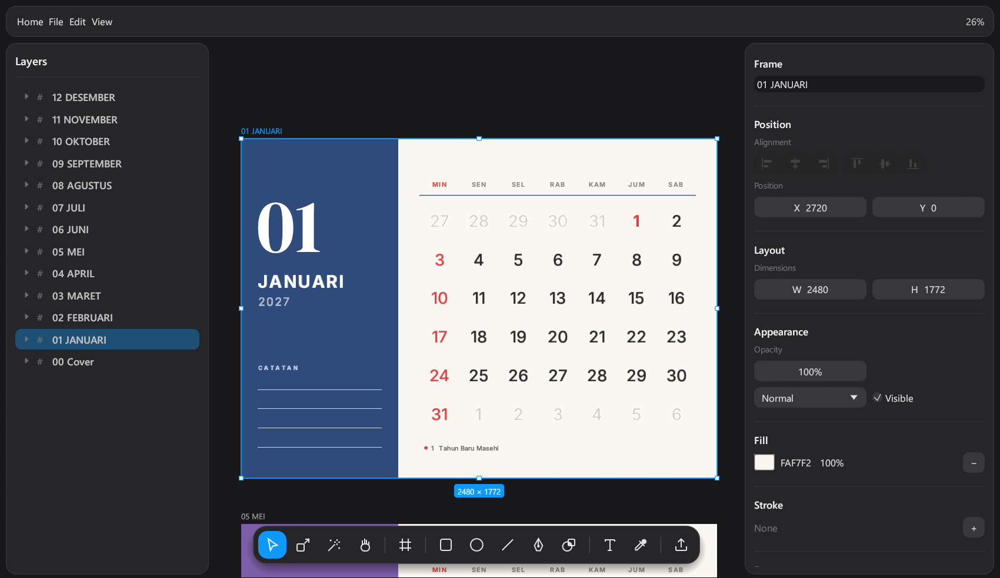
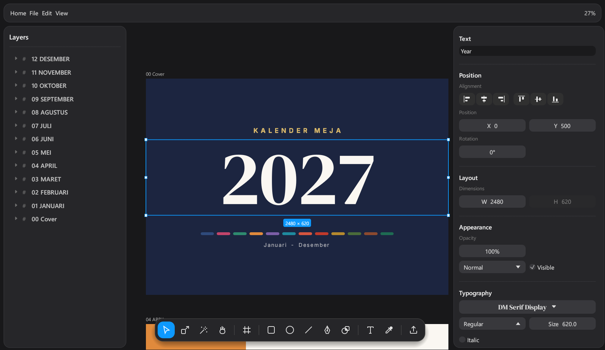
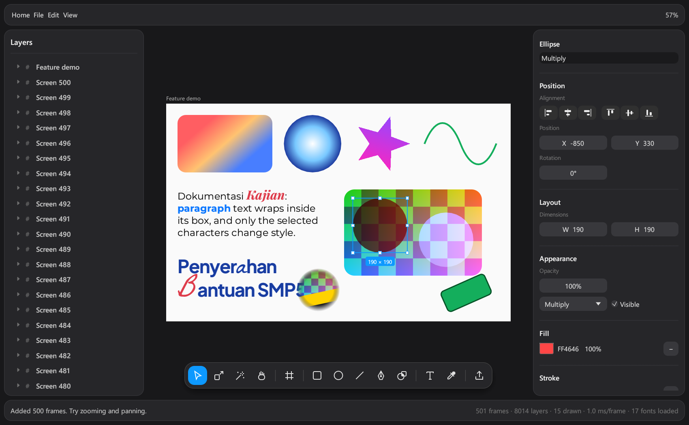
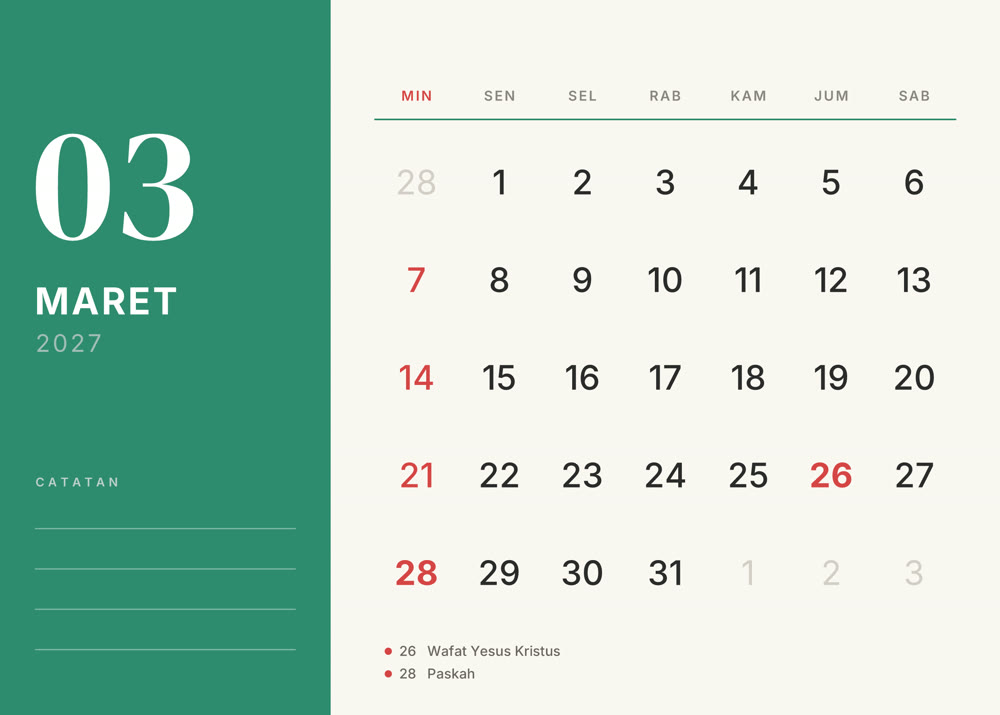

<h1 align="center">Kanvas</h1>

<p align="center">
  <b>A lightweight, native design editor for Windows, written in Rust.</b><br>
  Infinite canvas, unlimited frames, the whole Google Fonts catalog, vector tools and clean exports,<br>
  in a single 13 MB file with nothing to install.
</p>

<p align="center">
  
  
  
  
</p>

<p align="center">
  <a href="https://github.com/fadhelgame/Untitled/raw/master/Kanvas.exe"></a>
</p>

<br>

<p align="center">
  
  <br>
  <sub>A 13-page desk calendar on one canvas: every page is a frame, and every frame exports on its own.</sub>
</p>

<p align="center">
  <a href="#download">Download</a> ·
  <a href="#features">Features</a> ·
  <a href="#everything-in-the-box">Everything in the box</a> ·
  <a href="#made-with-kanvas">Made with Kanvas</a> ·
  <a href="#shortcuts">Shortcuts</a> ·
  <a href="#built-for-ai-assistants">AI assistants</a> ·
  <a href="#build-from-source">Build</a>
</p>

<br>

<table>
  <tr>
    <td width="25%" valign="top">
      <h3>⚡ Native and fast</h3>
      No Electron and no web view. Kanvas is one Rust program drawing on the GPU, and it stays smooth with hundreds of frames.
    </td>
    <td width="25%" valign="top">
      <h3>📦 Nothing to install</h3>
      One 13 MB <code>.exe</code>. Download it, double-click it, start designing. No account and no sign-in.
    </td>
    <td width="25%" valign="top">
      <h3>🔤 Every Google Font</h3>
      Browse the whole Google Fonts catalog with live previews. A font is downloaded the first time you use it, then kept for offline work.
    </td>
    <td width="25%" valign="top">
      <h3>🤖 AI-ready</h3>
      An optional MCP server lets an AI assistant read your document, build layouts and check the result, while you watch it happen.
    </td>
  </tr>
</table>

<br>

## Download

**[⬇ Download Kanvas.exe](https://github.com/fadhelgame/Untitled/raw/master/Kanvas.exe)** · Windows 64-bit · about 13 MB

1. Download the file.
2. Double-click `Kanvas.exe`. There is no installer.

> [!NOTE]
> The first time you open it, Windows may show **"Windows protected your PC"**, because the app is not code-signed yet. Click **More info → Run anyway**.

Google Fonts need an internet connection the first time a font is used. Everything else works offline.

## Features

Every screenshot here is the real app.

<table>
  <tr>
    <td width="50%" valign="top">
      
      <br>
      <sub>A selected frame, with its position, size, fill and stroke in the Design panel.</sub>
      <h3>Frames without limits</h3>
      Put as many frames as you like on one infinite canvas: a whole app flow, a slide deck, or twelve months of a calendar. Zoom from the big picture down to a single pixel.
      <br><br>
      <b>Nearly 60 frame presets</b> for phones, tablets, desktops, slides, watches, paper sizes (A3 to A6, Letter, business card) and social posts (Instagram, TikTok, X, Facebook).
    </td>
    <td width="50%" valign="top">
      
      <br>
      <sub>A 620 px headline in DM Serif Display, sharp at any zoom.</sub>
      <h3>Type that stays sharp</h3>
      Text is drawn from the font's own outlines, so a huge headline is as crisp as body text at every zoom level. Click for auto-width text, or drag for a paragraph box that wraps.
      <br><br>
      Change font, weight, size, color or italics for <b>just the selected characters</b>, and set line height, letter spacing and alignment for the whole block.
    </td>
  </tr>
  <tr>
    <td width="50%" valign="top">
      
      <br>
      <sub>Gradients, vector paths, styled text and a Multiply blend, in a document with 501 frames and 8,014 layers.</sub>
      <h3>Color, gradients and blending</h3>
      Solid fills, linear and radial gradients with draggable stops, strokes, opacity and corner radius. A built-in color picker with hex and alpha, plus an eyedropper with a pixel loupe that samples any pixel in the window.
      <br><br>
      <b>7 blend modes:</b> Normal, Darken, Multiply, Lighten, Screen, Plus lighter and Exclusion.
    </td>
    <td width="50%" valign="top">
      <h3>Vector tools</h3>
      Draw with the <b>Pen</b>: click for corners, drag for curves. Double-click any path to edit its points, add or remove anchors, or continue an open path.
      <br><br>
      The <b>Shape builder</b> splits overlapping shapes into regions. Drag across regions to merge them, Alt-click to remove them. The result is clean bezier curves, not jagged polygons.
      <h3>Select smarter</h3>
      The <b>Magic wand</b> selects every object that shares a property with the one you click, with a tolerance for near-matching colors. Objects snap to edges and centers of their neighbors with guide lines as you move them.
      <h3>Images</h3>
      Drop or paste PNG, JPEG, WebP, GIF, BMP and SVG. Round the corners, tint an icon with a color overlay, or use a clipping mask. The <i>Icons</i> button in the toolbar searches 200,000+ open-source icons (Iconify) and drops them in as recolorable SVGs; <i>Photos</i> searches free-to-use stock photos (Openverse) and keeps the author credit in the layer name. <i>Remove background</i> runs on your computer in a couple of seconds; the first use downloads a 170 MB model.
      <h3>Export exactly what you see</h3>
      Export a frame, a selection or the whole document to <b>PNG, JPG or SVG</b>, from 0.1x up to 16x. Text is exported as outlines, so the file looks the same on every computer.
    </td>
  </tr>
</table>

<br>

## Everything in the box

<table>
  <tr>
    <td width="33%" valign="top">
      <h4>🧰 Tools</h4>
      Move · Scale · Magic wand · Hand · Frame · Rectangle · Ellipse · Line · Pen · Shape builder · Text · Eyedropper · Export
    </td>
    <td width="33%" valign="top">
      <h4>🗃️ Layers</h4>
      A layer tree per frame, groups, clipping masks, show/hide, bring to front and send to back, alignment of several objects, duplicate with Alt+drag, rotation, and precise position and size fields.
    </td>
    <td width="33%" valign="top">
      <h4>💾 Files</h4>
      A home page with your recent files, auto-save for documents that already have a file, undo and redo, and the native <code>.kanvas</code> format.
    </td>
  </tr>
</table>

<br>

## Made with Kanvas

<table>
  <tr>
    <td width="50%"></td>
    <td width="50%"></td>
  </tr>
  <tr>
    <td width="50%"></td>
    <td width="50%"></td>
  </tr>
</table>

<p align="center"><sub>Pages from a 2027 desk calendar, designed and exported with Kanvas.</sub></p>

## Shortcuts

| Tools | | View and canvas | |
|---|---|---|---|
| `V` | Move | `Space` + drag | Pan |
| `K` | Scale | `Ctrl` + scroll | Zoom |
| `Y` | Magic wand | `Shift+0` / `1` / `2` | 100% / fit all / fit selection |
| `H` | Hand | `Ctrl+\` | Hide panels |
| `F` | Frame | **Editing** | |
| `R` | Rectangle | `Alt` + drag | Duplicate |
| `O` | Ellipse | `Shift` + drag | Lock axis |
| `L` | Line | `]` and `[` | Bring to front / send to back |
| `P` | Pen | `Ctrl+G` / `Ctrl+Shift+G` | Group / ungroup |
| `Shift+M` | Shape builder | `Ctrl+Alt+G` | Clipping mask |
| `T` | Text | `Alt+A` `D` `W` `S` | Align left / right / top / bottom |
| `I` | Eyedropper | `Alt+H` `V` | Align centers |
| | | `Shift+X` | Swap fill and stroke |
| | | `Ctrl+Z` / `Ctrl+Shift+Z` | Undo / redo |

While resizing, hold `Shift` to keep the ratio and `Alt` to resize from the center. Drag just outside a corner to rotate.

## Built for AI assistants

Kanvas ships with `kanvas-mcp`, a small [Model Context Protocol](https://modelcontextprotocol.io) server. It connects an AI assistant such as Claude to the document that is open in the app, over a local, token-protected connection that never leaves your computer.

The assistant gets 11 tools: `get_document`, `create_nodes`, `update_nodes`, `delete_nodes`, `arrange`, `select_nodes`, `screenshot`, `export`, `file`, `history` and `list_fonts`. Every change appears on your canvas immediately and is one undo step.

`kanvas-mcp` is not part of the download above; build it from source (see below), then register it with your assistant:

```json
{
  "mcpServers": {
    "kanvas": { "command": "C:\\path\\to\\kanvas-mcp.exe", "args": [] }
  }
}
```

## Build from source

You need [Rust](https://rustup.rs).

```sh
git clone https://github.com/fadhelgame/Untitled
cd Untitled
cargo build --release
```

The app is `target/release/kanvas.exe` and the MCP server is `target/release/kanvas-mcp.exe`.

## Under the hood

- **Rust and egui:** one native program, rendered with OpenGL through `eframe`.
- **One render path for export:** the document becomes SVG, and PNG and JPG are rasterized from that SVG with `resvg`, so every format matches the canvas.
- **Cheap undo:** top-level frames are shared between undo snapshots, so hundreds of frames stay light.
- **Vector text:** glyph outlines are tessellated into triangles with `lyon`, and boolean shape operations run on `i_overlay`.
